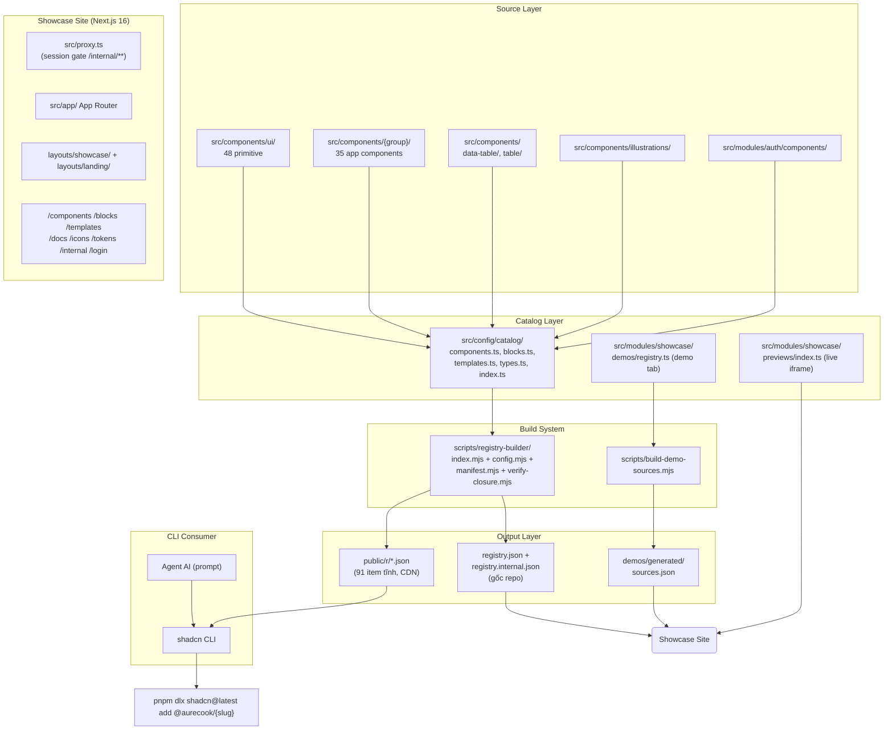

# System Architecture: Lnh-design

## 1. Overview

Lnh-design là registry UI theo mô hình shadcn (style `radix-mira`) — source components được copy vào repo người dùng thay vì import từ npm. Hệ thống gồm ba phần chính: (1) **Component Source** (`src/`), (2) **Showcase Site** (Next.js 16 App Router), và (3) **Registry Build System** (`scripts/`).

Registry JSON sinh tự động từ source, đảm bảo demo luôn đồng bộ với nội dung phát hành.

## 2. Architecture Diagram



## 3. Catalog & Component Layers

### 3.1. Hai layer component

Catalog (`src/config/catalog/`) là data thuần (không JSX) — script Node nạp trực tiếp được mà không cần bundler. Mỗi item có:

| Field | Ý nghĩa |
|-------|---------|
| `slug` | Trùng thư mục demo, tên registry item `@aurecook/{slug}`, và param `/preview/[name]` |
| `name` | Tên hiển thị (danh từ riêng, không dịch) |
| `description` | `{ vi, en }` nằm ngay trong data — thêm item mà quên dịch là lỗi kiểu |
| `categories` | 1-N trong 7 nhóm Ant Design |
| `kind` | `component` \| `block` \| `template` |
| `layer` | `primitive` \| `app` (chỉ component) |
| `visibility` | `public` \| `internal` |
| `isNew`, `thumbnail` | Tùy chọn |
| `blockKind` | `application` \| `data-grid` \| `solutions` (chỉ block) |
| `techStack`, `framework/base/style/surface` | Chỉ template |

Số liệu (xác minh 2026-10-18): **92 item** = 48 primitive + 35 app component + 8 block + 1 template (internal).

### 3.2. Primitive shadcn (`src/components/ui/`)

48 primitive Radix-based (Button, Dialog, Select, Stepper…) — **ẩn khỏi sidebar showcase** nhưng vẫn nằm trong registry vì app-level components phụ thuộc chúng.

### 3.3. App Components (`src/components/{group}/`)

35 component cấp app xây trên primitive, theo 7 nhóm Ant Design: `general`, `layout`, `navigation`, `data-entry`, `data-display`, `feedback`, `other`.

### 3.4. Blocks (8)

Cụm nhiều component ghép thành mảng giao diện chạy được:

| Block | blockKind | Nguồn chính |
|-------|-----------|-------------|
| `data-table` | data-grid | `src/components/data-table/` |
| `table-core` / `table-chrome` | data-grid | `src/components/table/` + `src/hooks/table/` + `src/lib/table/` |
| `data-table-url` | data-grid | Lớp URL-state (nuqs) quanh data-table |
| `stats-overview` | application | `src/modules/showcase/previews/layout.tsx` |
| `nav-tree` | application | `src/components/navigation/nav-item-recursive.tsx` |
| `empty-states` | application | `src/components/illustrations/` |
| `auth-login` | application | `src/modules/auth/components/` |

### 3.5. Templates (1)

`dev-portal` — template nhiều trang, `visibility: "internal"`, style `radix-mira`. Xem thêm tại [project-roadmap](./project-roadmap.md).

## 4. Data Flows

### 4.1. Registry Build Flow

```
src/config/catalog/* + registry.manifest.json
         ↓
scripts/registry-builder/index.mjs  (2 lượt)
    Lượt 1: giải glob files (hỗ trợ loại trừ "pattern") → bảng ownerOfFile
    Lượt 2: dựng item
    1. Read catalog (import trực tiếp 3 file data ESM)
    2. Resolve files: manifest.files glob, mặc định primitive = ui/{slug}.tsx
    3. Embed nội dung file vào JSON + hash sha256
    4. Suy dependency: import "@/…" → tra ownerOfFile;
       npm package → tra version trong package.json (bỏ react/react-dom/next)
    5. Validate:
       - Import cấm (FORBIDDEN_IMPORTS: @aurecook/*, @/lib/i18n)
       - Public item phụ thuộc internal item (leak) → fail
       - File không nằm trong TARGET_RULES → fail
       - verifyClosure: cây dependency khép kín
    6. Output: public/r/{name}.json (91) + public/r/registry.json
       + registry.json + registry.internal.json (tên "aurecook-x")
```

Ghi chú kiến trúc:
- Item "gói" (không có file, chỉ `registryDependencies`) là hợp lệ — cách để một block gom item đã có mà không phát lại file.
- `src/lib/utils.ts` nằm trong `PROVIDED_BY_INIT` — `shadcn init` tạo sẵn, item không mang theo.
- `TARGET_RULES` ánh xạ đường dẫn nguồn → `type` + `target` theo alias CLI (`@ui/`, `@components/`, `@hooks/`, `@lib/`, `~/`), để file đáp đúng alias của từng repo khách.

### 4.2. Demo Build Flow

```
src/modules/showcase/demos/{category}/{slug}/{demo-id}.tsx
         ↓
scripts/build-demo-sources.mjs
    1. Glob "*/*/*.tsx" → key "{slug}/{demo-id}"
    2. Bỏ qua item visibility "internal" (chặn leak tĩnh)
    3. Output: src/modules/showcase/demos/generated/sources.json (sorted)
         ↓
Tab "Mã nguồn" của trang component đọc từ sources.json
```

Một demo = một file → source là nội dung file nguyên văn: không AST, không cắt theo marker, không thể lệch với chính nó.

### 4.3. Live Preview Flow (riêng với demo tab)

`src/modules/showcase/previews/*.tsx` — `previewRegistry` map slug → JSX, render trong iframe qua `/preview/[name]`. Trang showcase tra `hasPreview(slug)` để biết item nào đã có demo, không có cờ `hasPreview` viết tay nào để lệch với thực tế.

### 4.4. CLI Install Flow

```
User: pnpm dlx shadcn@latest add @aurecook/app-button
         ↓
shadcn CLI reads: https://aurecook.vercel.app/r/app-button.json
         ↓
JSON chứa: registryDependencies (đủ namespace), files (nội dung nhúng), dependencies
         ↓
CLI đặt file theo alias @ui/ @components/ @hooks/ @lib/ của repo khách
```

## 5. Public vs Internal Registry

| Channel | Namespace | Đường dẫn | Auth |
|---------|-----------|-----------|------|
| Public | `@aurecook/*` | `https://aurecook.vercel.app/r/{name}.json` (tĩnh, CDN) | Không |
| Internal | `@aurecook-x/*` | `/r/internal/{name}.json` (route handler) | `Authorization: Bearer {AURECOOK_TOKEN}` |

**Quy tắc tối quan trọng**: Public item **không được** phụ thuộc internal item — registry builder fail ngay lúc build. Demo source của item internal cũng bị loại khỏi `sources.json` (chặn leak qua đường tĩnh).

## 6. Showcase Site Routes

| Route | Nội dung |
|-------|----------|
| `/` | Landing (`src/app/(landing)/`) |
| `/components` | Tổng quan component theo nhóm + số đếm |
| `/components/[slug]` | Chi tiết: demo tab (demoModules), props table, source, lệnh cài, dependencies |
| `/blocks`, `/blocks/[category]`, `/blocks/[category]/[slug]` | Blocks lọc theo `blockKind`/category |
| `/templates`, `/templates/[slug]` | Template gallery |
| `/docs` | Cài đặt và conventions |
| `/icons` | Icon browser — `ICON_NAMES` vẽ qua provider đang active |
| `/tokens` | Design token table (đọc từ globals.css) |
| `/internal` | Khu nội bộ, sau cổng session của `src/proxy.ts` |
| `/login` + `/api/auth/{login,logout}` | Đăng nhập nội bộ (cookie session) |
| `/preview/[name]` | Iframe preview theo slug |
| `/r/*` | Registry JSON tĩnh; `/r/internal/[name]` tự kiểm Bearer |

## 7. Auth & Proxy Gate

- `src/proxy.ts` (Next 16 thay thế middleware) — cổng duy nhất chặn `/internal/**` bằng session cookie (`SESSION_COOKIE`, `verifySession` từ `src/lib/auth/session`).
- `/r/internal/*.json` **không** qua proxy: dùng `Authorization: Bearer`, trả 401 cho CLI thay vì redirect. Route handler tự kiểm.
- Tài khoản nội bộ khai qua `AURECOOK_USERS` (`email:pbkdf2.<iterations>.<salt>.<hash>`, phân cách dấu **chấm** — không dùng `$` vì Next expand `$xxx` thành chuỗi rỗng).

## 8. State Management

| Tầng | Công cụ | Vị trí |
|------|---------|--------|
| Server data | TanStack Query | `src/lib/query/query-client.ts` (browser + server client, `CACHE_DURATIONS`) |
| Global UI state | Zustand | `src/store/appearance-store.ts` — store duy nhất (`sidebarStyle`, persist localStorage) |
| i18n | React Context | `src/lib/i18n/context.tsx` + cookie `NEXT_LOCALE` + `LanguageSwitcher` |
| URL state | nuqs | Block `data-table-url` |
| Local | useState/useReducer | Trong component |

## 9. Key Design Decisions

| Decision | Rationale |
|----------|-----------|
| Registry item trỏ thẳng vào `src/` | Demo chính là nội dung phát hành — item hỏng → demo hỏng, không có bản thứ hai |
| Dependency suy tự động từ import | Khai tay → mỗi lần thêm import = cơ hội quên, lỗi chỉ lộ ra ở máy người cài |
| Catalog là data thuần, không chứa JSX | Script Node đọc được mà không cần bundler; JSX preview tách riêng ở `previews/` |
| Demo source trích nguyên văn từ file | Một demo một file → source không thể lệch với chính nó |
| Icon qua `AppIcon` + provider (lucide active, hugeicons dự phòng); primitive `ui/` giữ lucide | Đổi thư viện = một dòng import trong `app-icon.tsx`; ESLint chặn import thẳng thư viện icon ngoài `icon-providers/` và `ui/` |
| Demo tab (nạp lười) tách khỏi live preview | `/components/[slug]` chỉ kéo chunk của component đang xem, không gộp mọi demo vào một barrel |

## 10. Environment Variables (xác minh từ .env.example)

| Variable | Purpose |
|----------|---------|
| `AURECOOK_SESSION_SECRET` | Ký cookie phiên, bắt buộc ≥32 ký tự |
| `AURECOOK_USERS` | Tài khoản nội bộ `email:pbkdf2.<iterations>.<salt>.<hash>`, phân cách dấu chấm |
| `AURECOOK_TOKEN` | Auth cho `/r/internal/*.json`, repo dùng đặt cùng giá trị rồi khai trong components.json |
| `AURECOOK_HOMEPAGE` | Domain ghi vào `homepage` của registry.json lúc build |

## 11. Build Pipeline

```
pnpm dev / pnpm build
         ↓
demos:build (scripts/build-demo-sources.mjs)
    → src/modules/showcase/demos/generated/sources.json
         ↓
registry:build (scripts/registry-builder/index.mjs)
    → public/r/{name}.json (91 item, tĩnh)
    → public/r/registry.json (index, đã strip content)
    → registry.json + registry.internal.json (gốc repo)
         ↓
next build
```

Generated files nằm trong `.gitignore` — suy ra hết được từ `src/`.

## 12. Change Log

- 2026-10-03: Tạo ban đầu via `docs:init`
- 2026-10-18: Cập nhật theo source đã xác minh — schema catalog mới (slug/layer/visibility/blockKind), tách demo tab khỏi live preview (previews/), registry build 2 lượt + TARGET_RULES + FORBIDDEN_IMPORTS (@aurecook/*, @/lib/i18n), block đủ 8, template dev-portal internal, route /login + /r/internal/[name], phần Auth & Proxy (proxy.ts) và State Management; xoá `src/templates/` (không tồn tại)
