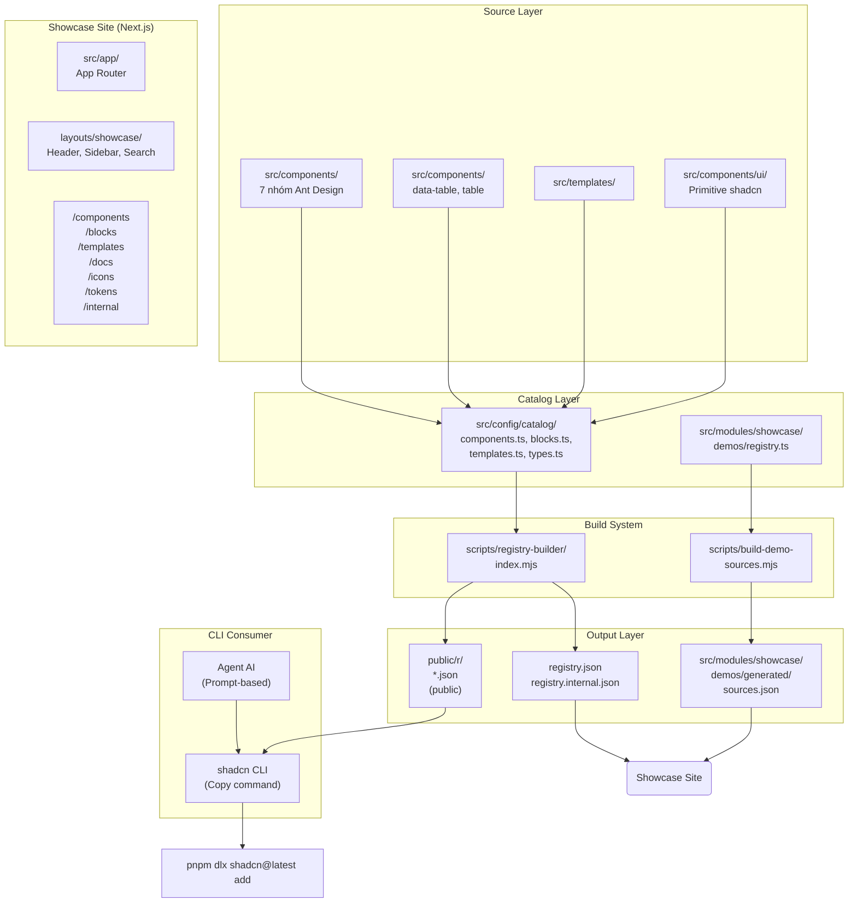

# System Architecture: Lnh-design

## 1. Overview

Lnh-design là registry UI theo mô hình shadcn — source components được copy vào repo người dùng thay vì import từ npm. Hệ thống gồm ba phần chính: (1) **Component Source** (src/), (2) **Showcase Site** (Next.js app), và (3) **Registry Build System** (scripts/).

Registry JSON được sinh tự động từ source, đảm bảo demo luôn đồng bộ với nội dung phát hành.

## 2. Architecture Diagram



## 3. Component Groups

### 3.1. Primitive shadcn (`src/components/ui/`)

Primitive Radix-based components (Button, Dialog, Select, etc.) — **ẩn khỏi showcase UI** nhưng vẫn nằm trong registry vì app-level components phụ thuộc chúng.

| Component | Path | Notes |
|-----------|------|-------|
| button | `src/components/ui/button.tsx` | Base component |
| dialog | `src/components/ui/dialog.tsx` | Radix Dialog |
| select | `src/components/ui/select.tsx` | Radix Select |
| ... | ~15 primitives | |

### 3.2. App Components (`src/components/{group}/`)

Component cấp app xây trên primitive shadcn, theo 7 nhóm Ant Design:

| Group | Example Components |
|-------|-------------------|
| `general/` | `app-button`, `actions-button`, `statistics-card`, `app-card` |
| `layout/` | Header, sidebar, container components |
| `navigation/` | `nav-tree`, breadcrumbs, tabs |
| `data-entry/` | Forms, inputs, `currency-input` |
| `data-display/` | Tables, lists, cards |
| `feedback/` | Toast, dialog, modal, alerts |
| `other/` | Misc components |

### 3.3. Block Components

Blocks là cụm nhiều component ghép thành mảng giao diện chạy được:

| Block | Path | Facets |
|-------|------|--------|
| `data-table` | `src/components/data-table/` | application, data-grid |
| `table-core` | `src/components/table/` | data-grid |
| `nav-tree` | `src/components/navigation/nav-tree.tsx` | application |
| `auth-login` | `src/modules/auth/` | application |

### 3.4. Templates

Template nhiều trang: `dev-portal` và có thể mở rộng.

## 4. Data Flows

### 4.1. Registry Build Flow

```
src/config/catalog/* + registry.manifest.json
         ↓
scripts/registry-builder/index.mjs
    1. Read catalog definitions
    2. For each item: resolve files from manifest
    3. Embed file contents into JSON
    4. Extract imports → resolve dependencies
    5. Validate:
       - No forbidden imports (@/lib/i18n)
       - No public → internal dependency leak
       - No file claimed by multiple items
       - Dependency tree is closed
    6. Output: public/r/*.json + registry.json + registry.internal.json
```

### 4.2. Demo Build Flow

```
src/modules/showcase/demos/{group}/{slug}/*.tsx
         ↓
scripts/build-demo-sources.mjs
    1. Read all demo files
    2. Extract source code
    3. Output: src/modules/showcase/demos/generated/sources.json
         ↓
Showcase tab "Mã nguồn" reads from sources.json
```

### 4.3. CLI Install Flow

```
User: pnpm dlx shadcn@latest add @aurecook/app-button
         ↓
shadcn CLI reads: https://aurecook.vercel.app/r/app-button.json
         ↓
JSON contains: registryDependencies, file contents, dependencies
         ↓
CLI copies files into user's src/ directory
```

## 5. Public vs Internal Registry

| Channel | Namespace | URL | Auth |
|---------|-----------|-----|------|
| Public | `@aurecook/*` | `https://aurecook.vercel.app/r/{name}.json` | None |
| Internal | `@aurecook-x/*` | `https://aurecook.vercel.app/r/internal/{name}.json` | `Authorization: Bearer {AURECOOK_TOKEN}` |

**Critical rule**: Public items **must not** depend on internal items — registry builder fails at build time if detected.

## 6. Showcase Site Routes

| Route | Content |
|-------|---------|
| `/components` | Tổng quan component theo nhóm |
| `/components/[slug]` | Chi tiết component: demos, source, install command, dependencies |
| `/blocks` | Blocks với filter theo kind/facet/group |
| `/templates` | Template gallery |
| `/docs` | Installation và conventions docs |
| `/icons` | Icon browser — `ICON_NAMES` vẽ qua provider đang active |
| `/tokens` | Design token table (đọc từ globals.css) |
| `/internal` | Internal registry browser, auth-protected |

## 7. Key Design Decisions

| Decision | Rationale |
|----------|-----------|
| Registry item trỏ thẳng vào `src/` | Demo chính là nội dung phát hành — item hỏng → demo hỏng, không có bản thứ hai |
| Dependency suy tự động từ import | Khai tay → mỗi lần thêm import = cơ hội quên, lỗi chỉ lộ ra ở máy người cài |
| Catalog là data thuần, không chứa JSX | Script Node đọc được mà không cần bundler |
| Demo source trích nguyên văn từ file | Một demo một file → source không thể lệch với chính nó |
| Icon qua `AppIcon` + provider (hiện hugeicons); primitive `ui/` giữ lucide | Đổi thư viện bằng một dòng import trong `app-icon.tsx`; ESLint chặn import thẳng thư viện icon ngoài `icon-providers/` và `ui/` |

## 8. Environment Variables

| Variable | Purpose |
|----------|---------|
| `AURECOOK_SESSION_SECRET` | Cookie signing (≥32 chars) |
| `AURECOOK_USERS` | Internal accounts: `email:pbkdf2...` |
| `AURECOOK_TOKEN` | Internal registry auth token |
| `AURECOOK_HOMEPAGE` | Domain for registry.json homepage field |

## 9. Build Pipeline

```
pnpm dev / pnpm build
         ↓
demos:build (scripts/build-demo-sources.mjs)
    → src/modules/showcase/demos/generated/sources.json
         ↓
registry:build (scripts/registry-builder/index.mjs)
    → public/r/*.json
    → registry.json
    → registry.internal.json
         ↓
next build
```

Generated files are in `.gitignore` — fully derivable from src/.

## 10. Change Log

- 2026-10-03: Initial system-architecture.md generation via `docs:init`
